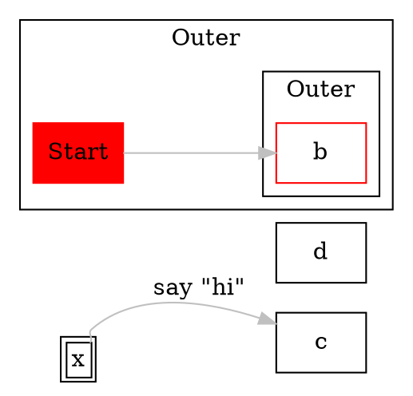

---
modules:
  - Graphvix.Render
---

# graphvix.render

## Purpose

Turns a `Graphvix.Graph` into DOT text, writes it to disk, and runs Graphviz's
`dot` to compile it. The DOT text is the library's main persisted format:
Graphviz reads its statements in order, so statement order, quoting, names and
whitespace are all part of what the component promises. It also surfaces
`graphvix.warnings` at the moment a graph is output, logging each warning
without ever refusing to produce output.

| Rev | Date | Change | Driver |
| --- | --- | --- | --- |
| 1 | 2026-11-14 | First Contract for 2.0, written ahead of the implementation | Graphvix 2.0 rewrite, contract-first |

## Scope

Owns: `Graphvix.to_dot/1`, `Graphvix.write/2`, `Graphvix.compile/3` (defined
on `Graphvix`, which delegates to `Graphvix.Render`); statement order and
whitespace; quoting and escaping of ids, names, ports and attribute values;
subgraph and cluster names; edge operators and endpoint syntax; how `Record`
and `HTMLRecord` labels are embedded; the automatic `shape` for record
labels; logging warnings at output time; writing `.dot` files and invoking
`dot`.

Does not own: building the structs (`graphvix.builder`); record label syntax
inside the label (`graphvix.records`, via `to_label/1`); deciding what is a
warning (`graphvix.warnings`); validating attribute values; layout.

## Environment facts

- Graphviz `dot` 13.0.0 (20250608.1624) parses every form this component
  emits. Checked by I16's `:graphviz` property, which runs `dot -Tcanon` on
  generated graphs.
- `dot` accepts port and compass endpoints written `"a":"p1":ne` and
  `"a":ne`, with the compass unquoted. Checked by the `:graphviz` test for I8.
- A `node [...]` default inside a subgraph applies only to nodes *created*
  after it: a node first declared at the root keeps the root's defaults even
  when a cluster lists it later. Verified with `dot -Tcanon` on 13.0.0;
  checked by the `:graphviz` test for I2.
- A cluster is a subgraph whose name starts with `cluster`. Graphviz checks
  the name string, so a quoted name (`subgraph "cluster_x"`) is a cluster.
  Checked by the `:graphviz` tests in `graphvix.warnings`.
- The `dot` executable is looked up on `PATH` when `compile/3` runs.
  Checked by the I15 tests.

## Public surface

- `Graphvix.to_dot(graph) :: String.t()`
- `Graphvix.write(graph, basename :: Path.t()) :: :ok | {:error, term()}` —
  writes `basename <> ".dot"`.
- `Graphvix.compile(graph, basename :: Path.t(), format :: atom() \\ :png) ::
  {:ok, Path.t()} | {:error, term()}` — writes `basename <> ".dot"` and
  `basename <> "." <> format`.
- `Graphvix.Render.to_dot(graph)`, `Graphvix.Render.write(graph, basename)`,
  `Graphvix.Render.compile(graph, basename, format)` — the implementations
  `Graphvix` delegates to.
- Log output: one `Logger.warning/1` call per entry of
  `Graphvix.warnings/1`, per output call.
- Persisted format: the DOT text described by I1–I12 and pinned by the worked
  example under Decisions.

#### Modules

`Graphvix.Render`. `Graphvix` itself is owned by `graphvix.builder`; its
`to_dot/1`, `write/2` and `compile/3` are one-line delegates.

## Invariants

### graphvix.render.I1 — Header names the graph G and its kind
- **scope:** `Graphvix.to_dot/1`
- **must:** start with `digraph G {` for a digraph and `graph G {` otherwise, prefixed by `strict ` when the graph is strict
- **why:** the graph is always named `G`, as in 1.x; `strict` and the graph kind are header keywords in DOT
- **kind:** persisted-format
- **record:** graph-named-g
- **status:** active

### graphvix.render.I2 — Statements are emitted in a fixed kind order
- **scope:** `Graphvix.to_dot/1`, every graph, subgraph and cluster block
- **must:** emit, in this order: graph attributes, the `node [...]` default, the `edge [...]` default (root only), subgraphs, clusters, the container's own nodes, edges (root only)
- **why:** a `node [...]` default applies only to nodes created after it; emitting nested containers before a container's own nodes lets cluster defaults reach nodes the caller also declared at the root, and root attributes still apply on top
- **kind:** ordering
- **record:** containers-before-nodes
- **status:** active

### graphvix.render.I3 — Each kind is emitted in definition order
- **scope:** `Graphvix.to_dot/1`
- **must:** within each kind, emit statements in the order they were first added, at every nesting depth; a node merged by re-adding appears once, at its first position
- **why:** "first cluster wins" placement depends on the order Graphviz reads statements, and `graphvix.warnings` walks the same order
- **kind:** ordering
- **status:** active

### graphvix.render.I4 — Whitespace is fixed
- **scope:** `Graphvix.to_dot/1`
- **must:** indent 2 spaces per nesting level and never use tabs; put one statement per line; end every node, edge, graph-attribute and `node`/`edge` default statement with `;`; close subgraph and cluster blocks with a bare `}`; emit no blank lines; end the output with `}` and one newline
- **why:** the text is a persisted format; one pinned layout keeps output byte-for-byte reproducible and diffable
- **kind:** persisted-format
- **record:** semicolons-everywhere
- **status:** active

### graphvix.render.I5 — Attribute lists are sorted and compact
- **scope:** `Graphvix.to_dot/1`
- **must:** render node and edge attributes and `node`/`edge` defaults as ` [k="v", k2="v2"]` with keys sorted by name, and omit the list when there are no attributes; render graph attributes as one `k="v";` line each, sorted by key; emit nothing for an empty attribute map
- **why:** attribute order has no meaning to Graphviz, so sorting makes the output deterministic
- **kind:** persisted-format
- **record:** sorted-attribute-keys
- **status:** active

### graphvix.render.I6 — Ids, names, ports and values are quoted safely
- **scope:** `Graphvix.to_dot/1`
- **must:** double-quote every node id, subgraph and cluster name, port and string attribute value; put a backslash before every `"` that is not already preceded by an odd run of backslashes (so `say "hi"` → `say \"hi\"`, and a caller's `\"` stays as written); add one backslash to an odd run of backslashes at the end of the string (`foo\` → `foo\\`); leave every other backslash as written
- **why:** quoting keeps ids that are DOT keywords or contain spaces valid; the DOT lexer pairs a backslash with the next character, so a quote must follow an odd run and the closing quote an even run, or the string runs on; other backslashes are preserved so Graphviz label escapes (`\n`, `\l`, `\N`) keep working
- **kind:** security
- **record:** backslash-preserved
- **status:** active

### graphvix.render.I7 — Subgraph and cluster names
- **scope:** `Graphvix.to_dot/1`
- **must:** emit a subgraph as `subgraph "<id>"` and a cluster as `subgraph "cluster_<id>"`, always adding the prefix (an id of `cluster_foo` is emitted `cluster_cluster_foo`)
- **why:** Graphviz only treats a subgraph as a cluster when its name starts with `cluster`; always prefixing is predictable where guessing whether the caller already did is not
- **kind:** persisted-format
- **record:** cluster-prefix-always
- **status:** active

### graphvix.render.I8 — Edge operator and endpoint syntax
- **scope:** `Graphvix.to_dot/1`
- **must:** join endpoints with `->` in a digraph and `--` otherwise; emit endpoints `"a"`, `{"a", "p"}` as `"a":"p"`, `{"a", "p", :ne}` as `"a":"p":ne` and `{"a", nil, :ne}` as `"a":ne`, compass unquoted; omit a compass that is not one of `n ne e se s sw w nw c _`
- **why:** DOT's edge syntax; an invalid compass is dropped (and reported by `graphvix.warnings`) so the edge still renders
- **kind:** persisted-format
- **status:** active

### graphvix.render.I9 — Record labels are embedded by kind
- **scope:** `Graphvix.to_dot/1`
- **must:** emit a `label` whose value is a `Graphvix.Record` as `label="<Record.to_label/1>"`, quoted and escaped per I6; emit a `label` whose value is a `Graphvix.HTMLRecord` as `label=<<HTMLRecord.to_label/1>>`, unquoted, on any element (node, edge, graph, subgraph, cluster, defaults)
- **why:** record syntax is a quoted string to DOT; HTML-like labels must be wrapped in `<` `>` and never quoted
- **kind:** persisted-format
- **status:** active

### graphvix.render.I10 — Record labels set the node shape unless the node does
- **scope:** `Graphvix.to_dot/1`
- **must:** add `shape="record"` to a node whose own `label` is a `Record` and `shape="plaintext"` to a node whose own `label` is an `HTMLRecord`, unless that node's own attributes set `shape`, in which case the caller's shape is emitted unchanged; a record label in a `node [...]` default never adds a shape
- **why:** a record label means nothing without the record shape; `plaintext` is the 1.x shape for HTML records; the caller's explicit shape always wins
- **kind:** functional
- **record:** html-plaintext-shape
- **status:** active

### graphvix.render.I11 — Non-string values are rendered as quoted text
- **scope:** `Graphvix.to_dot/1`
- **must:** render integer, float, atom and boolean attribute values with `to_string/1` and quote them per I6 (`fontsize: 10` → `fontsize="10"`, `fixedsize: true` → `fixedsize="true"`); omit an attribute whose value is `nil`, as if it were not set
- **why:** callers use numbers, atoms and booleans naturally; quoted text is valid DOT for every value; `nil` has no DOT spelling, and `to_string(nil)` would emit an empty value that overrides defaults
- **kind:** functional
- **status:** active

### graphvix.render.I12 — Attribute values are never rewritten
- **scope:** `Graphvix.to_dot/1`
- **must:** emit every attribute value as given (after I6 escaping); in particular `lhead`/`ltail` values are not translated to `cluster_` names
- **why:** silently rewriting values would make the output disagree with what the caller wrote; the docs tell callers to write `cluster_<id>`
- **kind:** functional
- **record:** values-never-rewritten
- **status:** active

### graphvix.render.I13 — Warnings are logged once per output call
- **scope:** `Graphvix.to_dot/1`, `Graphvix.write/2`, `Graphvix.compile/3`
- **must:** log every entry of `Graphvix.warnings/1` exactly once per call with `Logger.warning`, and still return the output; log nothing when there are no warnings
- **why:** warnings can only be determined once the whole graph exists, so output time is when the caller hears about them; they never stop output
- **kind:** non-functional
- **status:** active

### graphvix.render.I14 — write/2 writes the DOT text
- **scope:** `Graphvix.write/2`
- **must:** write `to_dot/1`'s output to `basename <> ".dot"` and return `:ok`, or `{:error, reason}` when the file cannot be written
- **why:** the 1.x `write/2` contract, with failure returned instead of raised
- **kind:** functional
- **status:** active

### graphvix.render.I15 — compile/3 runs dot and never raises
- **scope:** `Graphvix.compile/3`
- **must:** write `basename <> ".dot"`, run the `dot` found on `PATH` at call time with `-T<format>`, and return `{:ok, basename <> "." <> format}`; return `{:error, reason}` and never raise when `dot` is not on `PATH` or exits non-zero
- **why:** Graphviz is an external binary that may be missing; 1.x crashed on a non-zero exit
- **kind:** functional
- **status:** active

### graphvix.render.I16 — Output is always valid DOT
- **scope:** `Graphvix.to_dot/1`
- **must:** produce text that `dot` parses without error for every graph the builders can construct, including ids, ports and labels containing quotes, backslashes, newlines and DOT keywords
- **why:** the library's job is to produce input Graphviz accepts; a caller should never have to escape anything themselves
- **kind:** functional
- **status:** active

## Decisions

| Decision | Value | Reason | Record |
| --- | --- | --- | --- |
| Statement kind order | attrs, node default, edge default, subgraphs, clusters, own nodes, edges | cluster `node` defaults must reach root-declared nodes | containers-before-nodes |
| Statement terminator | `;` on every non-block statement | one uniform rule | semicolons-everywhere |
| Attribute key order | sorted by name | deterministic output | sorted-attribute-keys |
| Backslashes | preserved, except before a quote and at the end, where runs are made odd/even | keep `\n` `\l` `\N`; the closing quote always closes | backslash-preserved |
| Cluster name | always `cluster_<id>` | predictable | cluster-prefix-always |
| HTML record shape | `plaintext` | 1.x parity | html-plaintext-shape |
| Attribute values | never rewritten | output matches what the caller wrote | values-never-rewritten |
| Graph name | `G` | 1.x parity | graph-named-g |

Worked example. These calls:

```elixir
import Graphvix.HTMLRecord, only: [tr: 1, td: 2]
alias Graphvix.{Cluster, HTMLRecord, Subgraph}

Graphvix.new(strict: true)
|> Graphvix.set_attributes(:graph, rankdir: "LR")
|> Graphvix.set_attributes(:node, shape: "box")
|> Graphvix.set_attributes(:edge, color: "gray")
|> Graphvix.add_subgraph(
  Subgraph.new("s1")
  |> Subgraph.set_attributes(:graph, rank: "same")
  |> Subgraph.add_node("c")
  |> Subgraph.add_node("d")
)
|> Graphvix.add_cluster(
  Cluster.new("outer")
  |> Cluster.set_attributes(:graph, label: "Outer")
  |> Cluster.set_attributes(:node, color: "red")
  |> Cluster.add_cluster(Cluster.new("inner") |> Cluster.add_node("b"))
  |> Cluster.add_node("a", label: "Start")
)
|> Graphvix.add_node("a", style: "filled")
|> Graphvix.add_node("r", label: HTMLRecord.new([tr([td("x", port: "p1")])]))
|> Graphvix.add_edge("a", "b")
|> Graphvix.add_edge({"r", "p1", :ne}, "c", label: ~s(say "hi"))
|> Graphvix.to_dot()
```

must produce exactly (validated with `dot` 13.0.0):



## Orderings

- Statement order inside every block is I2's kind order, and I3's
  definition order within each kind. Silence here would make "first cluster
  wins" placement a coin flip.
- `Graphvix.warnings/1` is computed and logged before `to_dot/1` returns, and
  before `write/2` writes or `compile/3` runs `dot`, so a caller sees the
  warnings even when the file write or `dot` fails.
- `compile/3` writes the `.dot` file before running `dot` on it.

## Known limits

- Attribute values are not validated; an invalid value reaches Graphviz.
- `lhead`/`ltail` must be given the full `cluster_<id>` name.
- HTML elements beyond `table`, `tr`, `td`, `br` and `font` cannot be
  expressed.
- Edges cannot be placed inside subgraphs or clusters.
- The graph is always named `G`.

## Regeneration brief

A regenerator receives this intent, `render.decisions.yml`, the system
intent and records, `test/contract/graphvix/render_contract_test.exs`, and
public-surface stubs for `Graphvix.Render`. It also needs the builder and
records Contracts, since rendering reads their structs and calls
`Graphvix.Record.to_label/1`, `Graphvix.HTMLRecord.to_label/1` and
`Graphvix.warnings/1`.

Questions previous rounds asked, answered:

- *Do graph attributes use `graph [..]` or bare `k="v";` lines?* Bare lines,
  one per attribute, sorted (I5).
- *Is an empty block emitted for an empty cluster?* Yes: the
  `subgraph "cluster_x" {` line and a bare `}` at the same indent (I4).
- *Does a default `label` that is a `Record` add a shape?* No; only a node's
  own label does (I10).
- *What does a `nil` attribute value render as?* Nothing; the attribute is
  omitted (I11). Values other than strings, numbers, atoms, booleans, `nil`,
  `Record` and `HTMLRecord` are outside the Contract.
