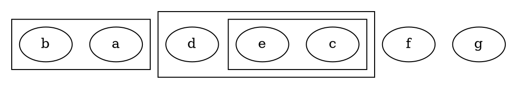

# Graphvix 2.0 — Contract design

Date: 2026-11-13
Status: draft, awaiting approval

## Intent

Graphvix 2.0 is a rewrite of the library as plain immutable Elixir data. The
deliverable of this piece of work is **the Contract** for 2.0, written in
Covenant's `contracts/` layout ahead of the implementation, so that 2.0 can be
built (and later regenerated) from it. Implementation is a separate, later
piece of work; this Contract is checked with `mix covenant.check --static`
until code exists.

What changes from 1.x:

- No `:digraph`/ETS state. The graph is an immutable struct; every operation
  returns a new value, so construction chains with pipes.
- Clusters and subgraphs nest arbitrarily.
- Vocabulary: graph, node, edge, subgraph, cluster, attribute ("vertex" is gone).
- Attributes are checked against the Graphviz attribute table and produce
  warnings, never errors.
- `Graphvix` is the public entry point.
- `Record` and `HTMLRecord` carry over from 1.x with the same capabilities.

## Goals

- A Contract complete enough that each component can be deleted and rebuilt
  from its Contract alone.
- The subtle Graphviz behaviours (cluster placement, output order, quoting)
  are stated as obligations with their reasons, and the placement rules are
  checked against real Graphviz output.
- Warnings catch the mistakes Graphviz silently tolerates.

## Non-goals

- Implementing 2.0 (next piece of work, planned separately).
- Edges inside subgraphs or clusters.
- Updating or removing an existing node or edge (re-adding a node merges; see below).
- HTML-like labels other than via `HTMLRecord`; HTML elements beyond the 1.x
  set (`b`, `i`, `u`, `img`, `hr`, `vr`, …).
- Validating attribute *values* (only whether an attribute exists and applies).
- `show/2` from 1.x (opening files is the OS's job).

## Anti-goals

- Failing a build or raising because of a questionable attribute or placement.
  Warnings only.
- Any change in behaviour that silently drops something the caller wrote
  (a node that vanishes from a cluster, an attribute lost to a merge) without
  a warning.
- Mutable or process-held state of any kind.
- Runtime dependencies. All current deps are dev/test only, and stay that way.

## Constraints

- Elixir `~> 1.20` (mix.exs). Covenant `~> 0.2` (dev/test).
- Graphviz `dot` is an external binary: required for `compile/3` and for the
  placement contract tests, not for building graphs or `to_dot/1`.
  Pinned environment fact: verified against Graphviz 13.0.0 (20250608.1624).
- Contract layout per Covenant's convention: `contracts/README.md`,
  `contracts/system/{intent.md,decisions.yml,scope.yml}`,
  `contracts/graphvix/<component>.{intent,obligations}.md`,
  `contracts/graphvix/<component>.decisions.yml`,
  `test/contract/graphvix/<component>_contract_test.exs`.

## Approaches considered

**A. Split by behaviour — chosen.** Five components (below). The risky
parts (rendering, warnings) get heavy form with a reason per rule; the simple
parts stay light; each component regenerates independently.

**B. One component per module** (Graph, Node, Edge, Cluster, …). Mirrors the
code, but placement rules span Graph, Cluster and rendering and would be
split or duplicated; several near-empty contracts for plain structs.
Rejected.

**C. One heavy component `graphvix.core`.** Simplest to write; regenerating
anything means regenerating everything, defeating per-component regeneration.
Rejected.

## Components

| Id | Form | Owns |
|----|------|------|
| `graphvix.builder` | light | `Graphvix` construction functions, `Graphvix.Graph`, `Node`, `Edge`, `Subgraph`, `Cluster` structs and their builders; merging, id normalization, immutability |
| `graphvix.records` | light | `Graphvix.Record`, `Graphvix.HTMLRecord`; their label rendering and content escaping; port listing |
| `graphvix.render` | heavy | `to_dot/1`, `write/2`, `compile/3`; statement order, quoting/escaping, names, ports, auto-shape, logging of warnings |
| `graphvix.warnings` | heavy | `warnings/1`; every warning kind; the cluster placement model; `dot -Tjson` contract tests |
| `graphvix.attribute_table` | light | the generated, checked-in attribute table and the mix task that regenerates it |

Housekeeping as part of this work: move `contract/README.md` to
`contracts/README.md` and remove `contract/` (including its empty
`coverage.json`). The stray root file `ok` is left alone for the user.

## Design decided in conversation

### Public API (`Graphvix`)

Every construction function returns a `%Graphvix.Graph{}`.

```elixir
Graphvix.new(opts \\ [])                         # digraph: true, strict: false
Graphvix.add_node(graph, id, attrs \\ [])
Graphvix.add_edge(graph, from, to, attrs \\ [])  # from/to: id | {id, port}
Graphvix.add_subgraph(graph, %Subgraph{})
Graphvix.add_cluster(graph, %Cluster{})
Graphvix.set_attributes(graph, :graph | :node | :edge, attrs)

Graphvix.to_dot(graph) :: String.t()
Graphvix.write(graph, basename)                  # see Rendering
Graphvix.compile(graph, basename, format \\ :png)
Graphvix.warnings(graph) :: [warning]
```

### Structs

- `Graph`: `digraph` (bool), `strict` (bool), `nodes`, `edges`, `subgraphs`,
  `clusters` (lists), `attributes: %{graph: %{}, node: %{}, edge: %{}}`.
- `Node`: `id`, `attributes`.
- `Edge`: `from`, `to`, `attributes`. No `label` field — label is an attribute.
- `Subgraph` and `Cluster`: `id` (required), `nodes`, `subgraphs`, `clusters`,
  `attributes: %{graph: %{}, node: %{}}` (no `:edge` key — edges live only at
  the root, so an edge default in a subgraph would apply to nothing).
- `Subgraph` and `Cluster` each have `add_node/3`, `add_subgraph/2`,
  `add_cluster/2`, all returning the receiving struct, so nested structures
  are built inside-out and then added to their parent.

### Node identity and merging

- Nodes are identified by a caller-chosen id. Ids may be given as strings,
  atoms or numbers and are stored as strings (`:a` and `"a"` are one node).
- Re-adding an id **in the same container** (graph, subgraph or cluster)
  merges: one entry, kept at its first position, attributes merged with later
  values winning. This mirrors how Graphviz reads `a [color=red]; a [shape=box]`.
  Re-adding is also how a node is "updated".
- Occurrences **across containers** are all kept exactly as built; nothing is
  merged or dropped in the structs. Conflicts are reported by `warnings/1`.
- Edges may name nodes never added; DOT creates them implicitly. No warning.
- Repeated edges are stored as separate edges (DOT multigraph). With
  `strict: true` the `strict` keyword is emitted and Graphviz merges; we do
  not model strictness.

### Edges

Edges exist only at the root graph. This is deliberate: an edge statement
inside a cluster pulls both endpoints into that cluster, which would be a
third, silent way for a node to change clusters. Adding `edges` to
subgraphs/clusters later is purely additive.

Endpoints are `id`, `{id, port}`, or `{id, port, compass_point}`. Ports
address `Record` / `HTMLRecord` cells. Compass points are the DOT set
`:n, :ne, :e, :se, :s, :sw, :w, :nw, :c, :_`.

- `{id, port, compass}` renders as `"a":"p1":ne` (compass unquoted).
- Compass without a port (my call): `{id, nil, compass}` renders as
  `"a":ne`. No port check applies.
- An invalid compass value (my call): warning kind 11, and the compass is
  omitted from the output, so the edge still renders (Graphviz would
  otherwise warn and ignore it anyway).

### Attributes

- `set_attributes(target, :graph | :node | :edge, attrs)` on `Graph`;
  `:graph | :node` on `Subgraph`/`Cluster`. Merges into that map, later wins.
- Keys may be atoms or strings; both name the same attribute.
- Values: strings, numbers, atoms, booleans (rendered via `to_string`), or a
  `%Record{}` / `%HTMLRecord{}` as the value of `label`.

### Records

Carried over from 1.x with the same builders:

- `Record.new(body)`, `row/1`, `column/1`; body is a string or nested
  rows/columns; a cell is a string or `{port, text}`; a plain list is a row.
  The 1.x second argument (node attributes) is **dropped**: a record is only
  a label value, and node attributes go on `add_node`. Breaking change,
  noted for migration.
- `HTMLRecord.new(rows, attrs \\ [])`, `tr/1`, `td/2`, `br/0`, `font/2`;
  tables nest inside cells; `td(…, port: "p")` defines a port; attribute names
  are hyphenated (`point_size` → `point-size`). Allowed attribute lists for
  table, td and font are the 1.x lists.
- A record attaches to a node as its label:
  `add_node(g, "a", label: Record.new(["x", {"p1", "y"}]), color: "blue")`.
  Works in subgraphs and clusters with no extra API.
- `HTMLRecord` is valid as any `label` (node, edge, graph, subgraph,
  cluster). `Record` is valid only as a node's own label; elsewhere it is
  warning kind 10. Auto-shape and port lookup consider only a node's own
  label, never `node [...]` defaults.
- HTML output is only possible via `HTMLRecord`. Plain strings are always
  quoted and escaped.
- Fixes over 1.x (each gets a contract test): record cell text escapes
  `{ } | < >` with a backslash; HTML cell text escapes `& < >` as entities.

### Rendering (`graphvix.render`)

- Whitespace is part of the persisted format and pinned by contract tests:
  - Indentation is 2 spaces per nesting level, never tabs.
  - One statement per line. Every node, edge, graph-attribute and
    `node`/`edge` default statement ends with `;` (my call to extend your
    node/edge rule to attribute statements, for one uniform rule). Subgraph
    and cluster blocks close with a bare `}`.
  - Attribute lists are `[k="v", k2="v2"]`: one space before `[`, `", "`
    between pairs. A node with no attributes is just `"a";`.
  - No blank lines. Output ends with `}` and a single trailing newline.
  - HTML labels are rendered on a single line (my call: 1.x emitted
    multi-line HTML, which makes indentation inside nested containers
    ambiguous).
- Pinned worked example (validated with `dot` 13.0.0):

  ```dot
  strict digraph G {
    rankdir="LR";
    node [shape="box"];
    edge [color="gray"];
    subgraph "s1" {
      rank="same";
      "c";
      "d";
    }
    subgraph "cluster_outer" {
      label="Outer";
      node [color="red"];
      subgraph "cluster_inner" {
        "b";
      }
      "a" [label="Start"];
    }
    "a" [style="filled"];
    "r" [label=<<table><tr><td port="p1">x</td></tr></table>>, shape="plaintext"];
    "a" -> "b";
    "r":"p1":ne -> "c" [label="say \"hi\""];
  }
  ```
- Header: `digraph G {` / `graph G {`, prefixed by `strict ` when strict.
  The graph is always named `G`.
- Edge operator `->` for digraphs, `--` otherwise.
- Statement order inside every container, recursively: graph attributes,
  `node [...]` defaults, `edge [...]` defaults (root only), subgraphs,
  clusters, **then** the container's own nodes, then edges (root only). Empty
  attribute maps produce no statement.
  - Nested containers come before a container's own nodes because a Graphviz
    `node [...]` default applies only to nodes *created after it*. With nodes
    first, a cluster's node defaults would silently miss every node already
    declared at the root (verified with `dot -Tcanon`, 13.0.0). With
    containers first, cluster defaults reach their members, and root/outer
    attributes still apply on top.
  - Within each kind, statements are emitted in **definition order**
    (insertion order); a merged node keeps its first position. Contract
    tests pin both the kind order and definition order within each kind,
    including after merges and across nesting levels.
  - This order is part of the contract because "first cluster wins" depends
    on the order Graphviz reads statements, and `warnings/1` walks the same
    order.
- Subgraphs are emitted with their id; clusters as `cluster_<id>`, always
  prefixed (an id of `cluster_foo` becomes `cluster_cluster_foo`).
- Attribute values are never rewritten: `lhead`/`ltail` must be written by the
  caller with the full `cluster_<id>` name, and the docs say so.
- Node ids, subgraph/cluster names and ports are always quoted. A port
  endpoint is emitted `"a":"p1"`.
- Attribute keys are emitted sorted by name, for deterministic output.
- A node whose label is a `Record` gets `shape="record"`, an `HTMLRecord`
  label gets `shape="plaintext"` (as in 1.x) — unless that node's own
  attributes set `shape`, in which case the caller's shape wins.
- `to_dot/1`, `write/2` and `compile/3` each log every entry of `warnings/1`
  exactly once with `Logger.warning` and still produce output.
- `write(graph, basename)` writes `basename.dot`; `compile(graph, basename,
  format)` writes `basename.dot` and runs `dot` to produce `basename.<format>`
  (1.x semantics). `compile` returns `{:error, reason}` rather than raising
  when `dot` is missing or fails.

### Warnings (`graphvix.warnings`)

`warnings/1` is pure and walks the graph in render order. Warnings are
determined only when the whole tree exists (inside-out construction means
nothing earlier knows the final shape). Kinds:

1. **Unknown attribute** — key not in the attribute table (catches `colour:`).
2. **Unsupported attribute** — key exists but its "used by" letters don't
   include the target: root graph attributes → `G`, subgraph → `S`,
   cluster → `C`, node attributes and `node [...]` defaults → `N`, edge
   attributes and `edge [...]` defaults → `E`.
3. **Node in clusters that don't contain each other** — Graphviz keeps the
   first in render order and silently drops the rest.
4. **Node in a cluster and in a cluster nested inside it** — Graphviz puts it
   in the deepest. Graphviz doesn't warn; we do because it is usually
   unintentional.
5. **Duplicate subgraph/cluster name** — DOT names are global; two clusters
   with the same id silently merge. A subgraph `x` and a cluster `x` don't
   clash (`x` vs `cluster_x`).
6. **Unknown port** — an edge endpoint names a port that no occurrence of that
   node's `Record`/`HTMLRecord` label defines (including nodes with no record
   label at all).
7. **Record label on a non-record shape** — `Record` label with a `shape`
   other than `record`/`Mrecord`; Graphviz would print the record syntax
   literally. `HTMLRecord` labels never trigger this.
8. **Unknown HTMLRecord attribute** — not in the 1.x allowed list for that
   element.
9. **Conflicting attribute across containers** — the same node has different
   explicit values for one attribute in different containers; Graphviz keeps
   the last one read, silently (`b [color=green]` at root, `b [color=blue]`
   in a cluster). The warning names the value that wins in render order.
10. **Record outside a node label** — a `Record` used as an edge, graph,
    subgraph or cluster label, or in a `node [...]` default; Graphviz would
    print the record syntax literally. (`HTMLRecord` is valid as any label.)
11. **Invalid compass point** — an edge endpoint's third element is not one
    of the ten DOT compass points; it is dropped from the output.

Placement rules (behind kinds 3 and 4):

- Root occurrences never anchor a node and never warn (declaring nodes at the
  root and grouping them later is normal).
- Plain subgraphs are transparent to placement; being in a subgraph never
  warns on its own. (Revised 2026-11-14 after final review: a subgraph that
  sets `rank` is *not* transparent unless the root sets `newrank`; it pins its
  nodes at its enclosing cluster level. The full rule, fuzzed against `dot`,
  is `graphvix.warnings.I4`.) A subgraph's cluster ancestry still counts. Exception:
  a `Subgraph` that Graphviz itself treats as a cluster (name starting with
  "cluster" in any case, or `cluster=true`) is a cluster for placement.
- Processing occurrences in render order: the first cluster occurrence sets
  the placement; a later occurrence in a descendant of the current cluster
  moves it deeper; a later occurrence in an ancestor keeps it where it is
  (verified: `c` seen in nested `cluster_y`, then in its parent, stays in
  `cluster_y`); any other later occurrence is ignored by Graphviz.

Worked example (user's, and `test.png`):



(Graphvix would emit the root nodes after the clusters; placement is the
same either way, since root occurrences never anchor.)
Placement: `a`,`b` in cluster1; `c`,`e` in cluster3; `d` in cluster2;
`f`,`g` at root. Warnings: `a` (kind 3: cluster1 kept, cluster3 ignored),
`c` (kind 4: cluster2 and nested cluster3, placed in cluster3).

**Placement verified against Graphviz.** Contract tests for kinds 3 and 4
render scenarios with `dot -Tjson` and compare against our model. In the JSON,
each cluster object's `nodes` lists the `_gvid`s of nodes placed in it *or any
descendant*; a node's placement is the deepest cluster listing it. (Checked on
13.0.0 with the example above: cluster3 lists only `c`, not `a`.) These tests
are tagged and skipped when `dot` is not on the PATH.

### Attribute table (`graphvix.attribute_table`)

- Generated from the Graphviz attribute reference (graphviz.org attrs page)
  by a mix task; the output is a checked-in data file, so normal builds never
  touch the network.
- Records, per attribute, the Graphviz "used by" letters (G, S, C, N, E), plus
  the source and Graphviz doc version/date it was generated from.
- Regenerating is a deliberate act; the diff is reviewed like code.

## Testing

The bar is **enough tests to enforce the Contract**, not a unit test for
everything.

- **Required:** every active obligation has at least one contract test in
  `test/contract/graphvix/<component>_contract_test.exs`, tagged with its
  obligation id. `mix covenant.check` enforces this.
- Contract tests follow the convention's rules: properties (StreamData) over
  pinned examples where a property fits; persisted formats (DOT text,
  whitespace, warning tuple shapes) pinned as literals; degenerate inputs
  (empty graph, empty cluster, duplicate ids, deep nesting) covered.
- **`dot` tests:** placement and the pinned worked example also run through
  Graphviz (`-Tjson` for placement, a parse/render check for output
  validity). They are tagged (e.g. `:graphviz`) and skipped when `dot` is
  not on the PATH.
- **Unit tests are optional.** Write one under `test/graphvix/` only where it
  earns its place, for example an internal helper whose edge cases are
  easier to probe directly than through the public API. Don't duplicate
  what a contract test already covers.
- The 1.x tests in `test/graphvix/` test the old API and are removed when 2.0
  replaces it, not ported.
- Doctests in module docs are welcome as documentation, but they don't count
  toward enforcing the Contract.

## Calls I made (not discussed; check these)

- `Subgraph.new(id)` / `Cluster.new(id)` constructors and
  `Subgraph.set_attributes/3` / `Cluster.set_attributes/3` exist — the spec
  needs them to build nested structures and set cluster attributes.
- Attribute keys are stored as strings in the structs (so atom and string keys
  merge correctly, and no atoms are created from user strings).
- Quoted-string escaping leaves `\` alone, so Graphviz label escapes like
  `\n`, `\l`, `\N` keep working, with two exceptions forced by the DOT
  lexer (which pairs a backslash with the next character): a `"` gets a
  backslash unless it already follows an odd run of backslashes, and an odd
  trailing run gets one more. (Revised 2026-11-14 during contract writing:
  escaping only `"` broke on a backslash directly before a quote.) This
  becomes a decision record.
- Duplicate-name checks (kind 5) compare emitted names, so a `Subgraph`
  `cluster_x` does clash with a `Cluster` `x`.
- Kind 9 and kind 10 tuple shapes: `{:conflicting_attribute, node_id, key,
  winner: {path, value}, others: [{path, value}]}`,
  `{:record_label_misplaced, target}`, `{:invalid_compass_point, {from, to},
  node_id, value}`.
- Warnings are tagged tuples: `{:unknown_attribute, target, key}`,
  `{:unsupported_attribute, target, key}`,
  `{:multiple_clusters, node_id, kept: path, ignored: [path]}`,
  `{:nested_clusters, node_id, placed: path, also: [path]}`,
  `{:duplicate_name, name, [path]}`, `{:unknown_port, {from, to}, node_id, port}`,
  `{:record_shape, node_id, shape}`,
  `{:unknown_html_attribute, node_id, element, key}`; `target` is one of
  `:graph`, `{:subgraph, path}`, `{:cluster, path}`, `{:node, id}`,
  `{:edge, from, to}`, `{:node_default, path}`, `{:edge_default, path}`;
  `path` is the list of container names from the root.
  Warnings that don't move a node's position (`kept`) give the `-Tjson` tests
  something to compare against directly.
- Re-adding a subgraph/cluster with an existing id does not merge; it is a
  duplicate-name warning.
- `write`/`compile` return `:ok | {:error, reason}` and
  `{:ok, output_path} | {:error, reason}` respectively.
- Heavy vs light form per component as in the table above.

## Left to the builder

- The data-file format of the attribute table and the mix task's name, and
  whether the task uses a dev-only HTML parser.
- Decision records (`decisions.yml`) for each choice above that a stranger
  would find arbitrary: placement model, edges-at-root, `cluster_` prefix,
  backslash handling, `plaintext` for HTML, sorted keys.
- Scope ceilings in `system/scope.yml`.
- StreamData generators for properties (ids, attribute maps, nested trees).
